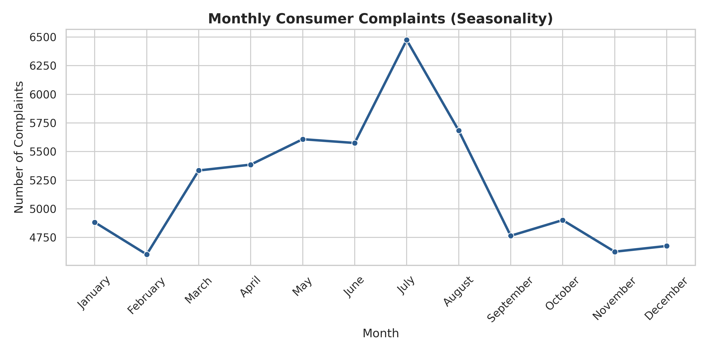
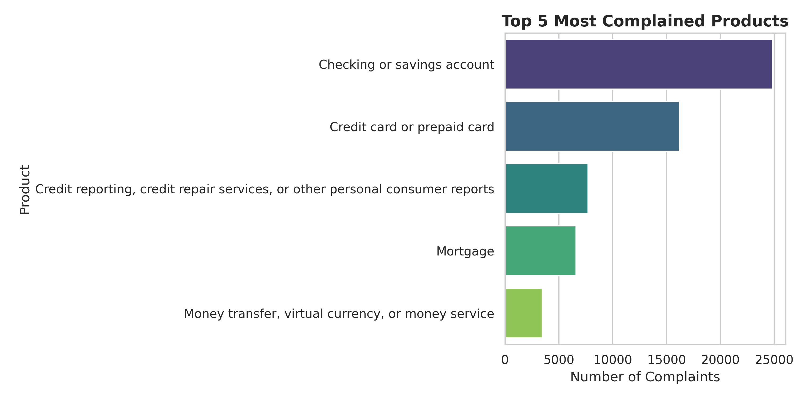
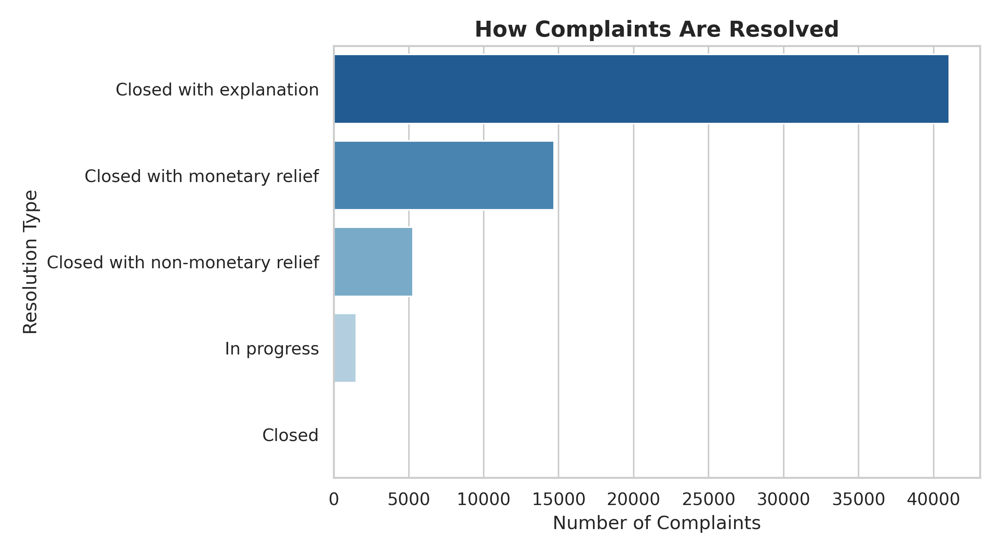
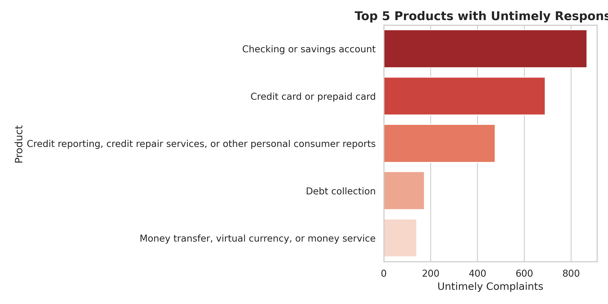

# Consumer Complaints Exploratory Data Analysis (EDA)

## Project Overview
An end-to-end data analysis project examining consumer financial disputes to uncover seasonal trends, top product pain points, resolution outcomes, and company response timeliness.

---

## Key Findings & Visualizations

### 1. Seasonal Patterns
Complaint volumes scale up during spring, peaking sharply in July (6,474 complaints) before dipping in late winter.

### 2. Top Complained Products
Checking and savings accounts represent nearly 40% of all consumer disputes, driven primarily by general account management issues.

### 3. Complaint Resolutions
Over 65% of complaints are resolved with a company explanation, and nearly 24% result in direct monetary relief for consumers.

### 4. Untimely Responses
Only 3.84% of complaints missed required response deadlines, primarily centered around checking/savings accounts submitted via the web.

---

## Tools Used
- **Python (Pandas, Seaborn, Matplotlib):** Data aggregation, cleaning, and visualization.
- **GitHub:** Portfolio version control and hosting.
